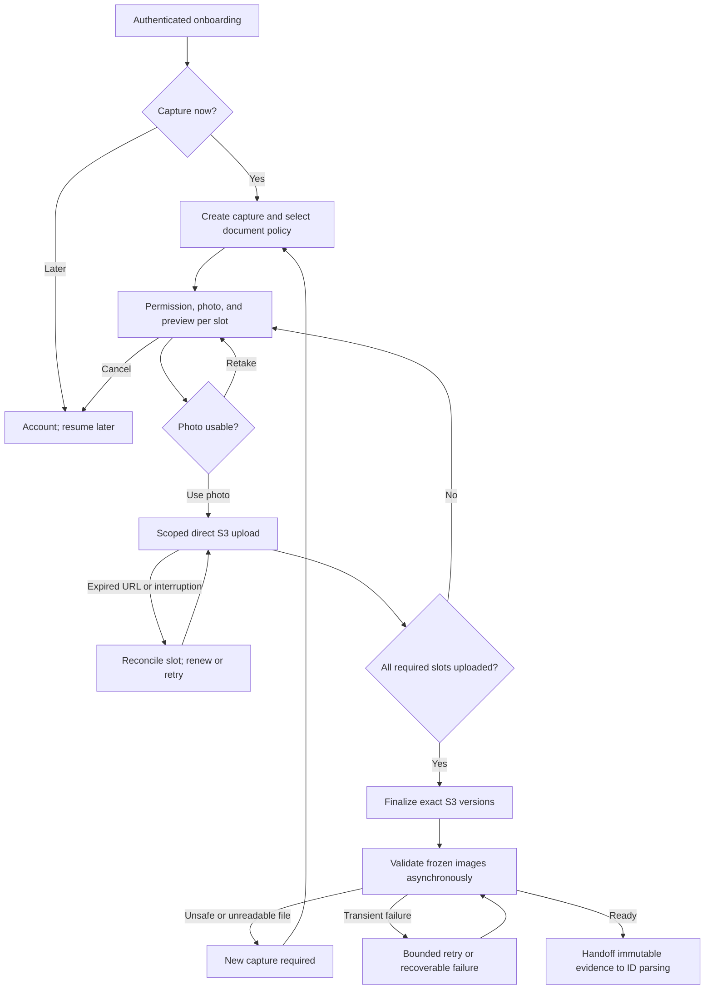

# ID capture flow

[Architecture](architecture.md) · [Parsing handoff](../id-parsing/flow.md)

Closing the screen is not cancellation of server work. A status timeout does not authorize creation of another capture; reconcile by the saved ID/idempotency key first. A parsing outcome is not part of this capture state machine.

## Implemented Android timing

The Continue to capture screen displays the localized purpose and retention. The accepted policy snapshot is checked again when creating a capture, and policy changes require renewed acceptance. After Continue and the policy check, the live camera slot requests Android permission directly if needed, without a second application explanation screen. A grant opens the two-sided camera; denial remains recoverable. Restoring processing or opening saved details does not request permission.

The current Android client starts upload and processing when both photos are
ready, during photo review. Confirmation controls when OCR can appear.
Retaking one side invalidates prior processing and submits the new pair under
the same capture ID. The client checks the image revision before showing OCR.
See the [current system journey](../../../docs/agents/journeys.md) and the
[Android recipe](https://raw.githubusercontent.com/lambdawalker/android.apexfission.auth/main/docs/agents/recipes.md).

Existing captured images resume loading or review. A matching server-confirmed review save returns automatically to account routing; Review ID details opens the saved form directly. See [parsing and review](../id-parsing/flow.md).
