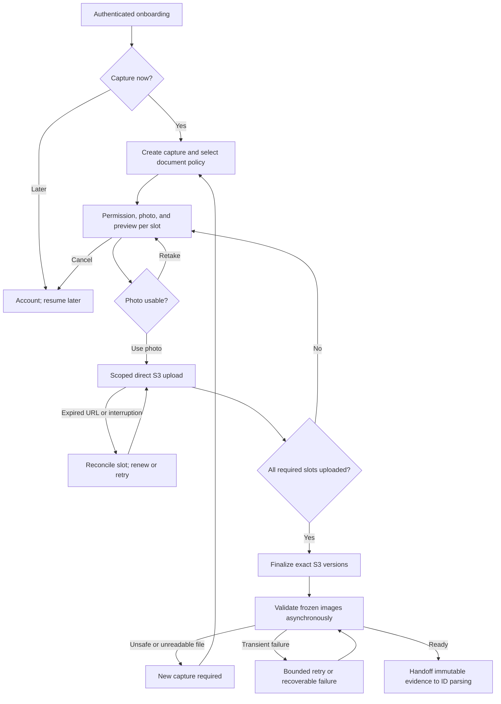

# ID capture flow

[Architecture](architecture.md) · [Parsing handoff](../id-parsing/flow.md)

Closing the screen is not cancellation of server work. A status timeout does not authorize creation of another capture; reconcile by the saved ID/idempotency key first. A parsing outcome is not part of this capture state machine.

## Current Android interaction

The existing Continue to capture screen displays the current localized purpose and retention. Its accepted policy snapshot is checked again when creating a capture; a policy change requires renewed acceptance. Continue opens the two-sided camera directly. Confirming the pair uploads both images and finalizes automatically, without another Start/Finish capture action.

Existing captured images resume loading or review instead of opening the camera. Loading covers file checks and pending extraction; foreground polling slows after the initial window and pauses in the background. Complete extraction supplies form values; failed extraction supplies empty manual entry. A confirmed review save leads to Details saved, with Done and Review details actions. See [parsing and review](../id-parsing/flow.md).
