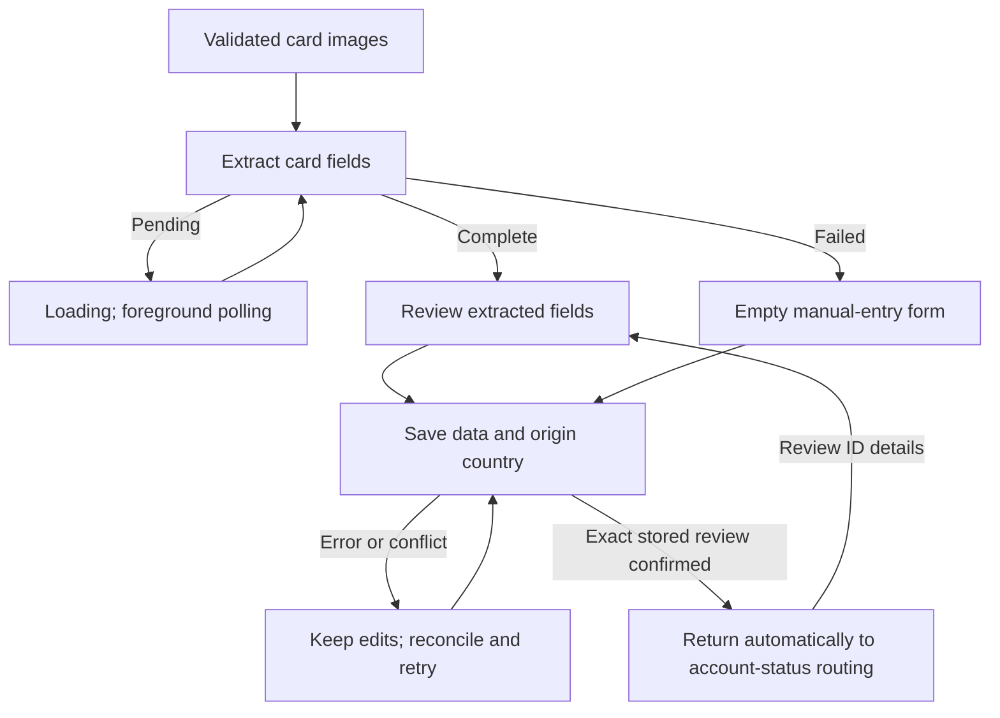

# ID parsing and review flow

Current behavior is defined by the [backend contract](https://raw.githubusercontent.com/lambdawalker/go.appexfission.aws.card-capture/main/docs/agents/index.md) and [Android flow](https://github.com/lambdawalker/android.apexfission.auth/blob/main/docs/identity-capture.md). The richer [architecture](architecture.md) remains a target beyond this implemented subset.

Android checks the capture ID and image revision before showing OCR after photo confirmation. Re-entry retrieves server status: processing shows loading, terminal extraction opens review, and the account action Review ID details opens the editable saved form directly. Other legacy/restoration entries may still expose the retained Details saved component; it is not a mandatory stop after a new successful save. No recapture is needed for an extraction failure. File-validation failures remain capture recovery states and must not be confused with extraction failure.

Only server-confirmed `reviewed` data matching the submitted fields and country of origin finishes the form. Lost save responses reconcile through status or an identical retry; conflicting edits remain visible. Unsaved drafts are memory-only. Review ID details reopens saved values for correction without first asking the user to open another review screen. Saving finishes the document-data step and does not invoke ID validation, approve identity or grant access. The account's capture/onboarding flags are not save acknowledgements.
