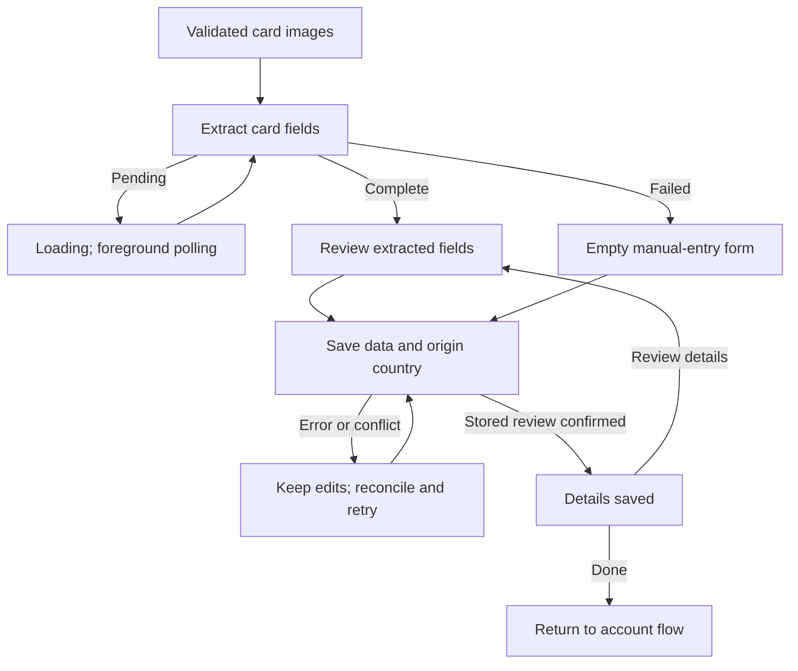

# ID parsing and review flow

Current behavior is defined by the [backend contract](https://github.com/lambdawalker/go.attestra.aws.auth/blob/main/docs/id-capture.md) and [Android flow](https://github.com/lambdawalker/android.attestra.auth/blob/main/docs/identity-capture.md). The richer [architecture](architecture.md) remains a target beyond this implemented subset.

Re-entry retrieves server status: processing shows loading, terminal extraction opens review, and an already stored review opens the finish screen. No recapture is needed for an extraction failure. File-validation failures remain capture recovery states and must not be confused with extraction failure.

Only server-confirmed `reviewed` data matching the submitted fields and country of origin finishes the form. Lost save responses reconcile through status or an identical retry; conflicting edits remain visible. Unsaved drafts are memory-only. Review details reopens saved values for correction. Saving finishes the document-data step and does not invoke ID validation, approve identity or grant access. The account's capture/onboarding flags are not save acknowledgements.
