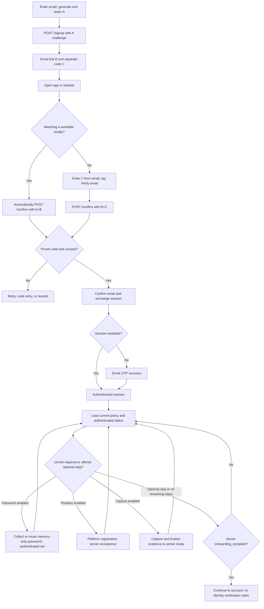

# Onboarding flow source

This is the current flow for the [onboarding architecture](architecture.md). The [legacy SVG](onboarding-flow.svg) is retained as a historical pre-split snapshot. Capture/parsing subflows have their own detailed diagrams.

Password may be collected with email but is submitted only after verification; loss of process or cross-device confirmation requires re-entry. Disabled enrollment is omitted. Optional skips are local choices, never substitutes for required durable facts. ID parsing/review can follow ready capture independently; capture is not identity verification. See [policy](policy.md).
